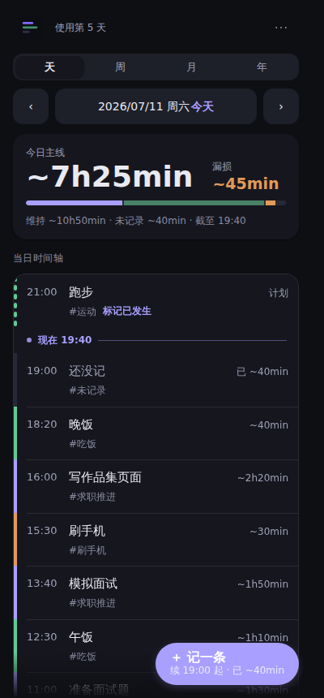
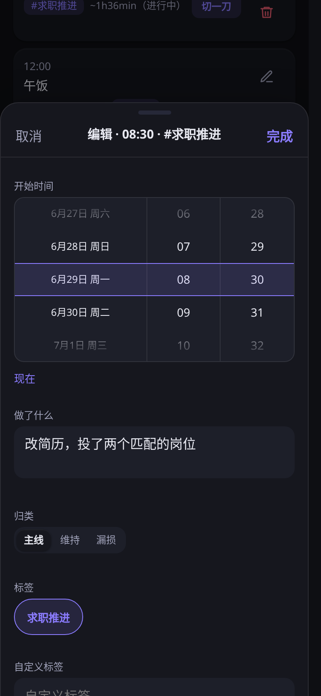

# 时间尺

> Status: active · 已上线，可日常使用；进度与待办见 [STATUS.md](STATUS.md)
>
> Release: v1.15.8（按钮组件清单与收敛，SPEC-016 B 期；发布状态见 [STATUS.md](STATUS.md)，适用范围见[真机验收单](docs/device-acceptance.md)）。
>
> Updated: 2026-11-27
>
> Intended user: 需要记录每天时间去向并进行每日复盘的个人使用者。
>
> Operating boundary: 本地静态 PWA，只记录时间去向，不做云同步、账号管理、KPI 考核或投资/合规判断。
>
> Risks and failure modes: 忘记记录导致“未记录”偏高、长时间间隔被整体计为未记录、周/月/年视图诱发过度复盘、浏览器本地数据或运行缓存被系统清理。

**5 秒记下真实做了什么——本地、离线、可信的一天时间线**

中文名**时间尺**，英文名 **Eigentime**。「5 秒」是降低记录成本的设计目标，尚无实测证明已达标。

应用地址：**https://time.eigentime.org/app/**。旧地址 `wowayou.github.io/time-logger/` 自 v76 起只读：可浏览、可导出，不能新增或编辑。





## 它是什么

自动统计（如 iPhone 屏幕使用时间）回答「设备被用了多久」，时间尺回答「你的一天去了哪里」：覆盖睡觉、通勤、面试这类不在屏幕上的时间；由你按主线 / 维持 / 偏航 / 未记录归类；说不清去向的时间显式显示为「未记录」。用法与理念见[《使用与理念》](使用与理念.md)。

- **核心闭环**：记录、计划、补录、完整区间编辑、切分、删除与撤销；天/周/月/年统计与时间分析；完整 JSON 备份、安全合并导入、Markdown 摘要。
- **形态**：纯静态、零运行时依赖、无构建的原生 ES modules PWA。数据只在当前设备该站点的 `localStorage`，没有账号、后端或云同步；首次联网缓存后可离线记录、统计和备份。
- **可靠性**：写操作走事务 planner、最新数据复核和结果签名；Service Worker 离线缓存，新版本需用户点击才更新；Chromium + WebKit 自动化覆盖主要交互、存储、导入和跨标签冲突。
- **已知限制**：iOS 主屏 PWA 有冷启动迟缓的真机记录，见 [P33](docs/postmortems.md)。导入是安全合并，不是整体替换或版本回退。安卓壳在独立仓库（D26），数据与 PWA 不互通；iOS 原生载体受 D17 门槛约束。
- **验证边界**：个人自用和自动化测试不等于市场验证。

## 文档入口

| 需要了解 | 唯一入口 |
|---|---|
| 当前进度、待办与阻塞 | [STATUS.md](STATUS.md) |
| 日常使用与四桶含义 | [使用与理念](使用与理念.md) |
| 维护规则、模块边界、版本仪式 | [CLAUDE.md](CLAUDE.md) |
| 改动是否值得做、开发与真机调试 | [CONTRIBUTING.md](CONTRIBUTING.md) |
| 接手须知、历史材料导航 | [docs/HANDOFF.md](docs/HANDOFF.md) |
| 候选方向及其门槛 | [docs/roadmap.md](docs/roadmap.md) |

决策理由见 [docs/decisions.md](docs/decisions.md)，故障根因见 [docs/postmortems.md](docs/postmortems.md)，版本记录见 `CLAUDE.md` 与 [docs/CHANGELOG.md](docs/CHANGELOG.md)。历史材料里的旧阶段安排不构成当前待办。

## 本地运行

应用使用原生 ES modules，请通过 HTTP server 打开，不要直接双击 `index.html`。

```bash
cd time-logger
python3 -m http.server 8080
# 浏览器打开 http://localhost:8080
# 手机同 Wi-Fi 调试：加 --bind 0.0.0.0，手机打开 http://<电脑的局域网 IP>:8080/
```

普通局域网 HTTP 只能测交互；离线缓存和安装更新需要 HTTPS，详见 [真机调试](CONTRIBUTING.md#本地真机调试)。装到主屏：iOS Safari「分享 → 添加到主屏幕」，Android Chrome「菜单 → 添加到主屏幕」。

## 维护审计

```bash
python3 scripts/project_audit.py
python3 scripts/confirm_logic_smoke.py
npm run typecheck
npm run test:ui
git diff --check
```

审计脚本检查版本锚点、图标、Service Worker 缓存、UI 红线、对外口径、README 演示图白名单与文档隐私红线；逻辑 smoke 覆盖区间事务、日边界和随机压测；Playwright 跑 Chromium 与 WebKit。npm 只用于开发期测试：`package.json` 保持 `"private": true`、`"type": "module"`，不新增运行时 `dependencies`，不提交 `node_modules/`、`test-results/`、`playwright-report/`。

## 文件地图

| 文件 | 作用 |
|---|---|
| `index.html` / `styles.css` | DOM 壳与全部样式 |
| `src/app.js` | 启动、导航、渲染调度、事件委托、SW 注册 |
| `src/ui.js` | 渲染模板与 DOM 更新 |
| `src/storage.js` | 本地数据/config 读写、导入预检与安全合并 |
| `src/stats.js` | 统计与按日分段 |
| `src/entry_model.js` | 日期模型、续记、区间编辑/切分/删除事务 planner |
| `src/sheet_controller.js` / `src/pickers.js` | 表单 sheet 与日期时间选择器 |
| `src/io_actions.js` | 摘要、复制、下载、导入、分享 |
| `src/time.js` / `src/i18n.js` / `src/locales/` | 时间工具与中英文文案 |
| `sw.js` / `manifest.webmanifest` / `icon.svg` / `icons/` / `packs/` | 离线缓存、PWA 清单、图标与内置句库 |
| `site/` / `scripts/build_site.py` | 产品主页、隐私与支持页及部署组装，不进应用缓存 |
| `native-contract.json` | Web 与安卓壳的接口约定 |
| `scripts/` / `tests/` / `playwright.config.js` | 审计、smoke、版本脚本与 UI 测试 |
| `docs/assets/` | README 固定演示数据截图，不放真实记录 |

## 发布与隐私边界

Web 发布用两个仓库（D12）：本仓 `wowayou/time-logger` 是唯一源码，它自己的 Pages 是只读旧站；`wowayou/time-logger-site` 是部署镜像，只放 `scripts/build_site.py` 的产物，绑定 `time.eigentime.org`（`/` 主页、`/app/` 应用）。`v<major>.<minor>.<patch>` tag push 触发发布；只改主页时手动发布。自己 fork 部署时一个仓库直发根目录即可。

数据只在每台设备本机的 `localStorage['timelog.v1']`，访问站点不会上传或同步。多设备迁移靠原设备「存储备份」JSON、新设备「导入」。不要提交父目录、`toolkit/`、`archive/`、导出的 `timelog-*.json`、真实记录或截图；README 展示图只用 `docs/assets/` 的固定演示数据 PNG。

## 数据模型

记录在 `localStorage['timelog.v1']`，标签配置在 `timelog.config`，文字轮播句库（若用过）在 `timelog.quotes`。完整备份包含 `entries`、`config`、可选 `meta` 与可选 `quotes`；没有可选字段的旧备份仍可导入，旧版本会忽略 `quotes`。

```json
{
  "version": 1,
  "meta": {
    "exportedAt": "2026-06-30T04:00:00.000Z",
    "sourceTimezoneOffsetMinutes": -480,
    "sourceTimeZone": "Asia/Shanghai"
  },
  "entries": [
    {
      "id": "abc123",
      "ts": "2026-06-28T09:00",
      "what": "写简历",
      "tags": ["当前主线"],
      "longConfirm": { "startTs": "2026-06-28T09:00", "endTs": "2026-06-28T13:10" }
    }
  ]
}
```

- **点存储 + 区间 UX**：每条记录只存起点 `ts`，段的结束由右邻记录或结算点实时派生。编辑、切分、删除先由纯事务 planner 算出结果与预览，提交前在最新数据上重算；原记录已在别处改动或删除时保留草稿、拦下覆盖。
- **日边界**：本地自然日 00:00 是硬边界；空日不继承前一天标签；跨日闭合段最多切入次日。今天无右邻时结算到当前时间，其它日子结算到 24:00。
- **统计**：标签派生为 4 桶——主线 `job`、维持 `maintain`、偏航 `leak`（显示名「偏航」，内部键不变）、未记录 `unrecorded`；孤儿标签和「未知」计为未记录。分钟数是权威值，百分比只作展示。长段待核默认关闭，开启后只加提醒、不改归桶。
- **偏好与失败**：界面偏好写不进时只在当前页面会话保留；记录、配置与句库的读写失败会明确提示，权限被拒与空间不足分开说明，草稿保留，不假报成功。

规则全文见 [CLAUDE.md](CLAUDE.md) 的代码约定。

## 功能清单

- 记录与编辑完整开始—结束区间；今日尾段可选「至今」或固定结束
- 删除前展示确切结果，删除后 8 秒内可撤销
- 段内补录与切分：先看结果（原段、比例切分条、逐段行），再用段内滚轮选开始与结束，一键贴边
- 时间轴三种布局：全文（默认，正文完整换行，时长看数字与尺子刻度）、单行、按时长；统计卡片可在比例条与分布图之间切换（日 / 周为热力格，月 / 年为按标签分的环形图）
- 触摸左滑露出编辑/删除；鼠标与键盘点行编辑
- 计划模式：计划不计入统计，到点可「标记已发生」
- 「做了什么」联想：输入一两个字列出以前写过的事项，点一下填入并选回当时的标签
- 正文自动选标签：写的内容就是某个标签的名字，或和以前记过的事一字不差时，直接选中那个标签（可一键「不选」；自己选过就不再自动改）
- 新建防错：误关表单时没保存的内容留在页面里、再打开即填回；写了内容却没选标签时提醒会记为「未知」
- 天/周/月/年视图，「正在做」状态条，「更多 → 时间分析」看所看周期的对比、常态、趋势、事项排行、关键词汇总，以及「全部」的累计与历史检索
- 移动端日期时分滚轮、桌面日历与精确输入（必须写完整日期时间）
- 阶段格言或文字轮播（导入书摘或一键添加内置主题句库，每天一句）
- 标签高级设置：标签云、就地编辑、筛选、改名迁移历史、合并前预览；录入时同名标签跨桶会提醒
- 中英文界面、自动/亮/暗主题；切换语言不改写已有标签
- 完整备份（复制 / 存储 / 分享）与逐条处理冲突的安全合并导入；当前视图 Markdown 摘要
- 离线可用；新版本提示后由用户点击更新

## 支持作者（自愿）

若时间尺对你有用，可以在[支持页](https://time.eigentime.org/support/?from=time-logger)自愿支持作者。所有功能始终免费、无广告无内购，支持不购买功能、优先权或产品方向；内置的三套主题句库所有人都能用，支持页提供同一批 TXT 与通用感谢卡。见 [D35](docs/decisions.md#d35)、[D36](docs/decisions.md#d36)。

## 许可证与版权

时间尺由 **wowayou** 开发并版权所有（© 2026 wowayou）。

- **开源许可**：以 [AGPL-3.0-or-later](LICENSE) 发布。你可以自由使用、研究、修改与再分发；**通过网络对外提供服务时也必须向用户开放对应源码**（AGPL §13），衍生作品须以同一许可证开源。
- **商用 / 双许可**：作为唯一著作权人，作者保留在 AGPL 之外另行授权的权利。若需在闭源或无法满足 AGPL 义务的场景下商用，可通过 [项目仓库](https://github.com/wowayou/time-logger) 联系另谈授权。

每个运行时文件顶部都带 `SPDX-License-Identifier` 标识；界面文案与代码可公开，个人数据始终只留在本机、永不上传。
